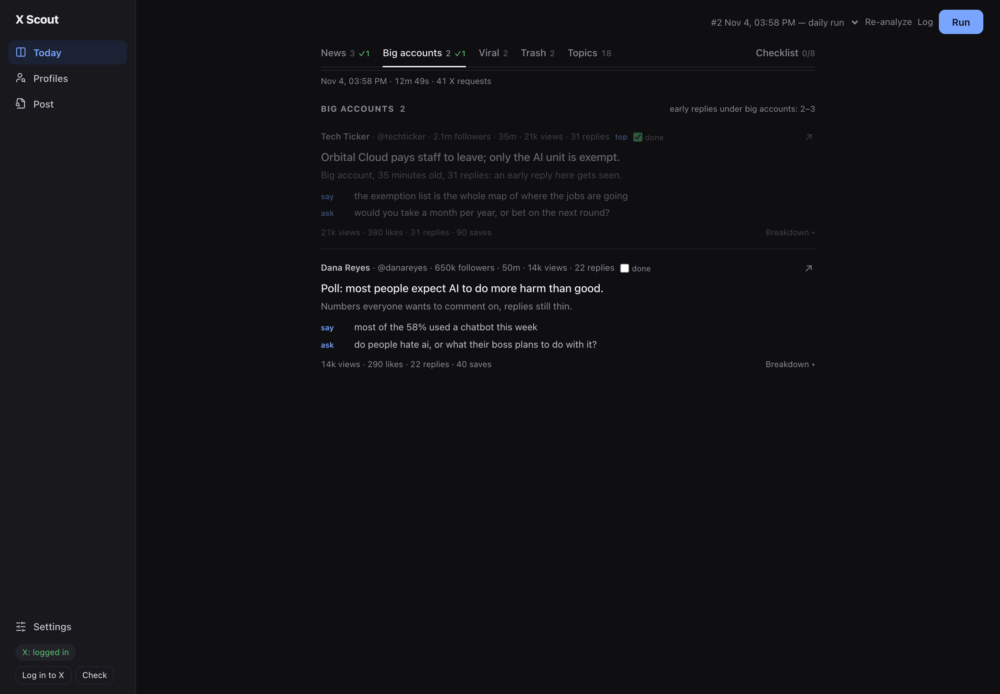
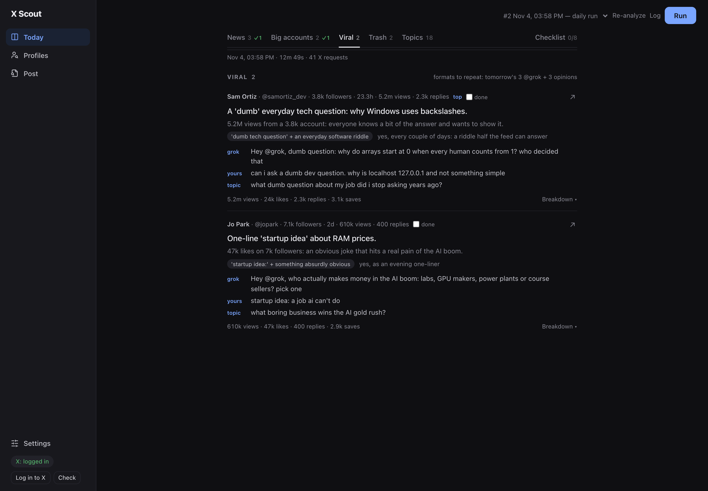
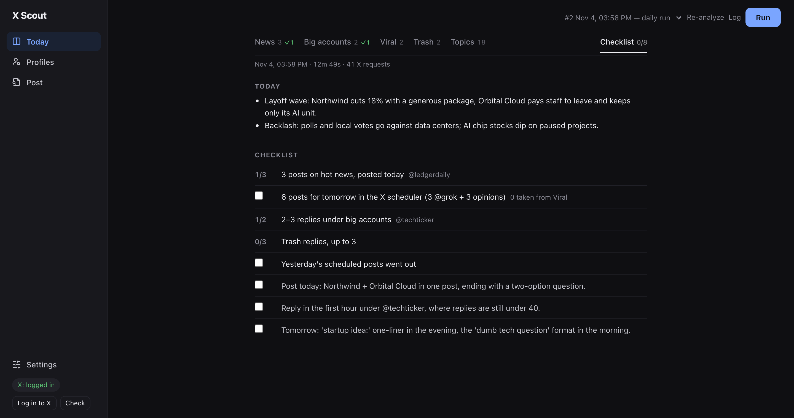
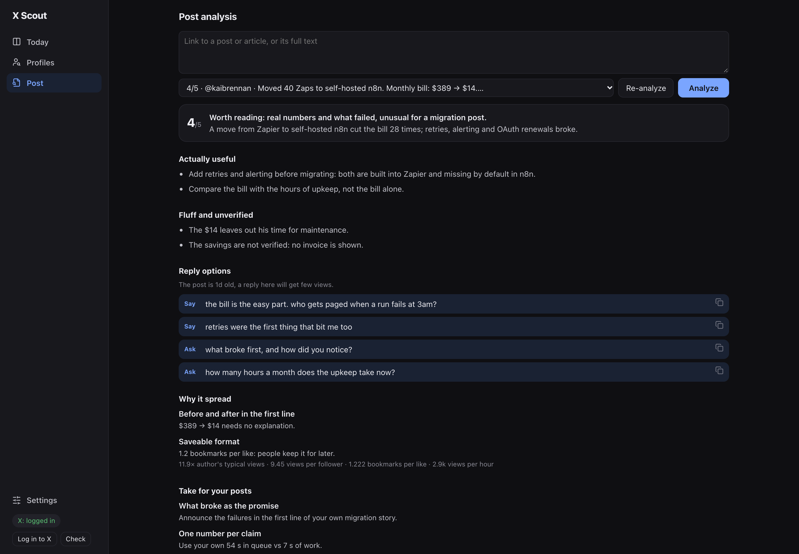
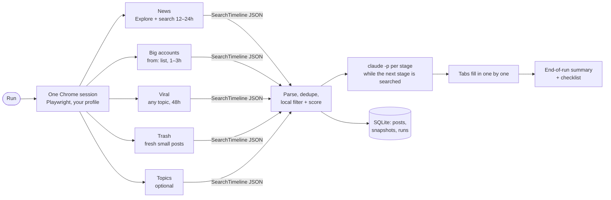

<div align="center">

# X Scout

**Your daily X routine behind one button.** Hot news to post about, fresh posts from big accounts to reply under, viral formats to repeat tomorrow, and a checklist. It reads X in your own Chrome at a human pace, and Claude does the reading for you.

[](https://github.com/Sentimenta1ist/x-scout/actions/workflows/test.yml)


[Daily run](#the-daily-run) · [A real run](#a-real-run-in-numbers) · [Quick start](#quick-start) · [How it works](#how-it-works) · [Cost](#token-cost) · [Safety](#volume-and-safety)


<sub>All screenshots use made-up demo accounts (<code>scripts/demo.py</code>).</sub>

</div>

## Why

Growing on X is mostly a routine: find what everyone is talking about, post on it fast, reply early under big accounts, and steal good formats. Doing that by scrolling takes an hour or more a day, and you still miss things.

X Scout does the scrolling. You press **Run**, go answer your own replies, and the tabs fill in one by one. In about 15 minutes you have:

- **3 stories worth posting about today**, each with ready post drafts;
- **fresh posts from big accounts** where the replies are not flooded yet, with two reply drafts each;
- **formats that went viral in the last 48 hours**, with a `Hey @grok` version, your own rewrite and an opinion topic for tomorrow;
- **a checklist** that counts what you actually did, plus Claude's recommendations for the day.

X Scout never posts, likes, follows or clicks. It reads, Claude drafts, you write and send.

## The daily run

One button runs five stages in order. Claude analyzes a stage while the next one is being searched, so you can start on News while Viral is still loading.

| Tab | What lands there | Your job |
|---|---|---|
| **News** | The biggest stories of the last 12–24 h (X Explore → News plus wide search): what happened, why it is hot, 2–3 post drafts | Post on 3 of them today |
| **Big accounts** | Posts from large accounts that are 1–3 hours old and still have few replies, with a *say* and an *ask* reply | 2–3 early replies |
| **Viral** | Posts that took off in the last 48 h on any topic, labeled by format: can you repeat it, a `Hey @grok` version, your own rewrite, an opposite-view quote, an opinion topic | Plan tomorrow: 3 @grok + 3 opinion posts |
| **Trash** | Fresh small and mid-size posts for quick light replies. Daily limit in Settings, connect / follow-for-follow replies are banned in the prompt | A few short replies, under the limit |
| **Topics** | Optional: your own topics, Reply / Read columns, each post with a full breakdown | Read and reply if you want |
| **Checklist** | Ticks from every tab, manual items (tomorrow's posts scheduled, yesterday's went out, weekly own-profile check) and Claude's recommendations | Close the day |

<table>
<tr>
<td width="50%"></td>
<td width="50%"></td>
</tr>
<tr>
<td align="center"><sub>Big accounts: reply while the thread is young</sub></td>
<td align="center"><sub>Viral: what format worked, and your version of it</sub></td>
</tr>
</table>

Every card has a **done** box. Boxes belong to the run: a new Run starts clean, and the Checklist counts them.



## A real run in numbers

The first full run on a live account (November 2026, Opus on every stage):

| Stage | Posts read | Picks | Claude in / out tokens | Time in Claude | API-price equivalent |
|---|---:|---:|---:|---:|---:|
| News | 112 + 12 Explore trends | 8 | 7.2k / 3.8k | 45 s | $0.13 |
| Big accounts | 49 | 8 | 6.3k / 2.5k | 31 s | $0.10 |
| Viral | 119 | 9 | 6.6k / 6.6k | 66 s | $0.19 |
| Trash | 78 | 6 | 6.5k / 0.9k | 12 s | $0.07 |
| Topics (5 topics) | 319 | 18 | 42.3k / 11.2k | 39 s | $0.54 |
| End-of-run summary | | | 5.0k / 1.5k | 18 s | $0.07 |
| **Total** | **677** | **49** | | | **$1.10** |

**12 min 49 s** end to end, **41 search requests** to X, **no rate-limit wait and no 429**. Most of the time is deliberate pauses between searches. Without Topics the run is about half as long and costs about half as much. With Sonnet instead of Opus it is several times cheaper.

The dollar column is what the same tokens would cost on the API. X Scout calls your logged-in Claude Code CLI, so on a subscription you are not billed per run.

## More than the daily run

### Profile analysis

Type any handle in **Profiles** to see which of its posts broke out and why, how its reach grew, and what you can repeat on your own account. Use it weekly on your own handle: the checklist reminds you.

<table>
<tr>
<td width="50%"></td>
<td width="50%"></td>
</tr>
</table>

| Tab | What is there |
|---|---|
| **Overview** | Four numbers, Claude's short take, the first three things to try |
| **Repeat for me** | 5–8 tactics adapted to your profile, each with a one-week test, plus what not to copy |
| **Viral posts** | Top posts with numbers and why each worked |
| **Growth** | Views per post on a log scale, 7- and 30-post medians, breakouts, phases |
| **Details** | Hooks and structures, format mix, posting hours, article chains, borrowed reach, every post with CSV export |

- Reads up to 300 posts or 120 days, plus up to 60 replies (all in Settings). A few minutes per account.
- **Metrics are local.** A breakout is a post with at least 5× the median views of the previous 30 original posts.
- **Growth is inference.** X does not expose follower history, so phases come from steps in the views median and are labeled as such. Every scrape saves a snapshot, so a real history builds up over time.
- One `claude -p` call (Sonnet by default). It suggests structures, never copied text: suggestions that repeat 8+ words of a post are dropped.

### Post analysis

Paste a link or the text of a post or an X Article into **Post**. One screen tells you whether it is useful or just viral: a 1–5 usefulness score, what you can apply, what is fluff or unverified, why it spread, reply options, and whether to repeat it, with a fill-in template. About $0.04 per post.



## Quick start

You need macOS or Linux, **Google Chrome**, [uv](https://docs.astral.sh/uv/) and [Claude Code](https://claude.com/claude-code), logged in, with `claude` on your PATH. No Anthropic API key and no X API key.

```bash
git clone https://github.com/Sentimenta1ist/x-scout.git
cd x-scout
./run                 # on macOS you can also double-click "X Scout.command"
```

The app opens at http://127.0.0.1:8765.

1. **Log in to X.** Click *Log in to X*: a Chrome window opens and closes itself once you reach the home feed. The session lives in `data/browser-profile` and lasts for months. **Use a secondary account**: any automation carries some risk for the account that runs it, and reading from a second account keeps your main one clean.
2. **Settings.** Set your handle (for the weekly self-check), the daily trash limit, and optionally your own list of big accounts and topics. Write a few lines in **About me**: what you post about, your opinions, what is noise. See [`profile.example.md`](profile.example.md).
3. **Run.** Work on each tab as it turns ready.

### Try it without an X account

```bash
X_SCOUT_DATA=./demo-data uv run python scripts/demo.py
X_SCOUT_DATA=./demo-data uv run x-scout
```

This seeds a daily run, a topics run, a profile and a post analysis, all with made-up accounts.

## Make it yours

The stage prompts are opinionated. They target one specific playbook: growth through volume, reacting to AI, jobs and tech news, and `@grok` questions. That is the author's current strategy. To change it:

- **About me** (`data/profile.md`, editable in Settings) is read on every stage. Your topics, opinions and voice go there, and the opposite-view quotes are built against it.
- **Stage prompts, search queries and filters** live in [`x_scout/stages.py`](x_scout/stages.py): one block per stage, with the time windows, `min_faves` thresholds and the default big-account list.
- **Stages can be turned off** one by one in Settings. Topics is optional and the slowest.

## Settings

| Setting | Default | What it does |
|---|---|---|
| Stages | all on | Turn News, Big accounts, Viral, Trash and Topics on or off |
| Big accounts | built-in list of ~25 | Handles whose fresh posts go to the Big accounts tab |
| Trash limit | 3 | Trash replies per day. The checklist warns above it |
| Your handle | — | Your own account, for the weekly profile check |
| Model | `sonnet` | `opus` is more thorough, `haiku` is cheaper |
| Summary language | `English` | Language of the per-post summaries, e.g. `Russian` |
| Topics | 2 examples | Up to 10, each with an optional X query (`OR`, quotes, `-exclude`, `from:`), extra queries and known authors. Empty query: Claude writes one |
| Posts per search / candidates | 50 / 50 | Topics stage: posts read per search and posts per topic sent to Claude. Extra queries are off by default: they cost rate limit |
| Profile limits | 300 posts, 120 days, 60 replies | How far back Profiles reads |
| Headless | on | Turn off to watch the browser work |

Only in `data/settings.json`: `search_pause` (default `[10, 20]` seconds between two searches of a daily run).

Optional `.env` (see [`.env.example`](.env.example)): `PORT`, `CLAUDE_BIN`, `CLAUDE_MODEL`, `X_SCOUT_DATA`.

## How it works



- **Real Chrome, no DOM scraping.** Playwright drives your installed Google Chrome with its own profile and reads the JSON X sends to its own web app (`SearchTimeline`, Explore). Nothing is clicked.
- **One session, one rate budget.** The whole run shares one browser and one request budget. It reads X's `x-rate-limit-remaining` / `-reset` headers and waits for the reset (up to 16 min) instead of running into a 429.
- **Local first.** Posts are parsed, deduped and filtered locally (age, size, reach, no giveaways). Only the best candidates go to Claude as compact lines, not raw JSON.
- **One Claude call per stage** with its own short prompt. A failed stage falls back to local ranking and the others keep their picks. **Re-analyze** reruns Claude on stored candidates without touching X: use it to tune prompts.
- **Virality score** (0–100) for topics: projected views from age, engagement per view, reach compared with the author's usual level, and acceleration between runs. Ported from [x-viral-radar](https://github.com/Sentimenta1ist/x-viral-radar).

What Claude actually receives per post, one line each:

```
12|@techticker|2.1m|35m|21k|380|31|90|[img]Orbital Cloud offers voluntary exits to staff in four countries…
```

Posts are referenced by a local index (`12`), not by 19-digit IDs, and Claude answers in a compact line format that the app parses.

## Token cost

`claude -p` runs with a short custom system prompt, `--tools ""`, `--setting-sources ""` and an empty working directory. That keeps Claude Code's own overhead at about 1.5k tokens instead of about 20k for a default session. Answers come as plain lines rather than `--json-schema`, because structured output costs a second model turn that re-reads the whole prompt:

| Output format (3 topics × 25 posts, Sonnet) | Input | Output | Time |
|---|---:|---:|---:|
| `--json-schema` | 15.0k | 4.9k | 33 s |
| line format (used) | 6.0k | 1.6k | 15 s |

A daily run without Topics is about 30k input and 15k output tokens. Every run shows its exact tokens, time and API-price equivalent per stage.

## Volume and safety

- **Human pace.** One browser, one page, 10–20 s between searches, a few scrolls per search. A full run is about 40 searches.
- **No background crawling.** Runs start only when you press **Run**. **Stop** cancels at any point.
- **Limits are respected.** It waits for X's rate-limit reset. If X still answers 429, or the login is gone, the stages already read are kept and analyzed.
- **Read-only.** Nothing is ever liked, followed, posted, quoted or clicked. Use a secondary account anyway.

## Data and privacy

Everything stays on your machine, in `data/` (gitignored):

| Path | Contents |
|---|---|
| `x-scout.db` | Posts, metric snapshots, runs with their stages, picks and done boxes |
| `browser-profile/` | The Chrome profile with your X session |
| `settings.json`, `profile.md` | Your settings and About me |
| `posts/` | Analyzed posts: parsed post, report, raw X JSON |
| `profiles/<handle>/` | Profile scrapes (gzipped), analyses, `snapshots.jsonl` |

The only network traffic is Chrome talking to x.com and the Claude CLI talking to Anthropic.

## Development

```bash
uv run pytest                                   # 98 tests: parsers, scoring, stages, candidate filters, line parsers
X_SCOUT_DATA=./demo-data PORT=8798 uv run x-scout
uv run python scripts/screenshots.py http://127.0.0.1:8798   # re-render docs/img from the demo server
```

```
x_scout/
  pipeline.py          run orchestration: daily run, topics, profiles, live state, settings
  stages.py            daily-run stages: queries, local filters, prompts, line parser, cards
  browser.py           Playwright session, rate budget, search / Explore / profile / post capture
  parse.py             X GraphQL JSON → flat posts (handles schema variants)
  scoring.py           virality score
  analyze.py           topics: candidate selection, compact digest, claude -p, reply parsing
  profile_metrics.py   profile analysis: breakouts, medians, cadence, phases
  profile_analysis.py  profile analysis: digest, prompt, parsing
  profile_store.py     data/profiles/<handle>/ files
  post_analysis.py     post analysis: link or text, prompt, parsing
  db.py                SQLite
  app.py               FastAPI API + static UI
  static/              index.html, app.js, day.js, profile.js, post.js, style.css (no build step)
```

## FAQ

**Does it post for me?** No, and it never will. It reads and drafts, and you send. Auto-posting is the fastest way to get an account limited.

**Can it work without logging in?** No. X search requires an account. You log in once and the session lasts for months.

**Why not the official X API?** Search access is expensive for a personal tool, and the web app's own JSON has everything needed.

**Does it need an Anthropic API key?** No. It uses your logged-in Claude Code CLI.

**X changed something and a tab is empty.** X renames its GraphQL operations and moves fields from time to time. The log then says `X returned no search data`. The fix is usually a few lines in `parse.py`.

## License

[MIT](LICENSE). Not affiliated with X Corp. or Anthropic.
