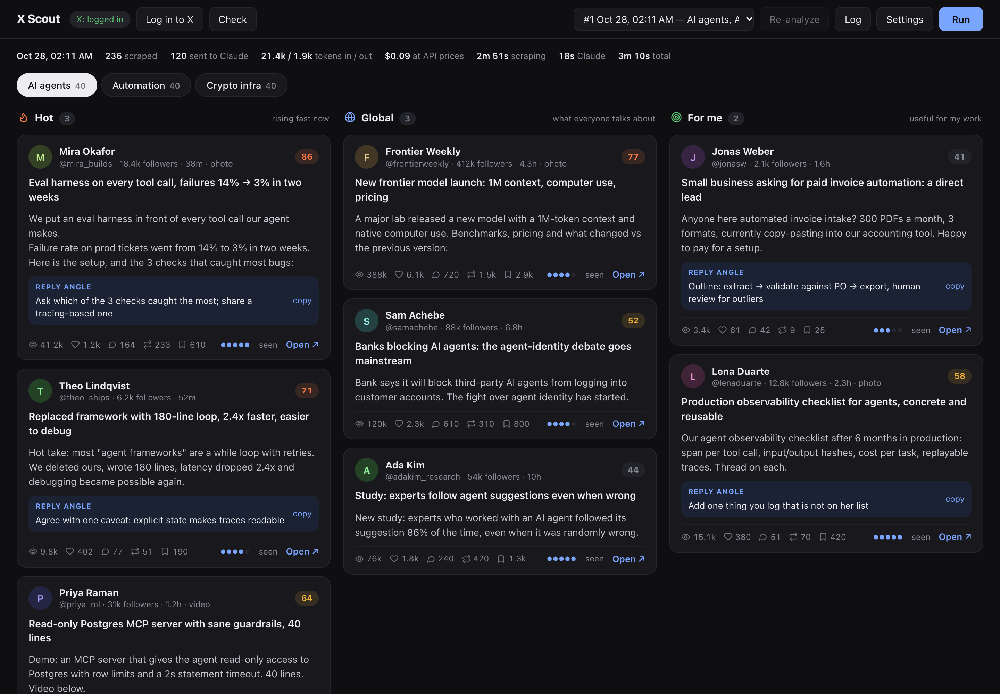
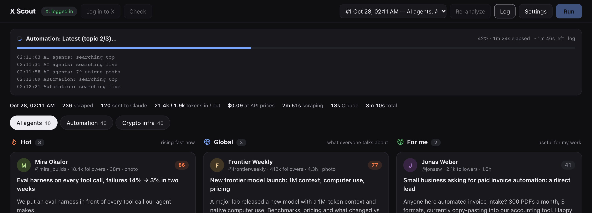
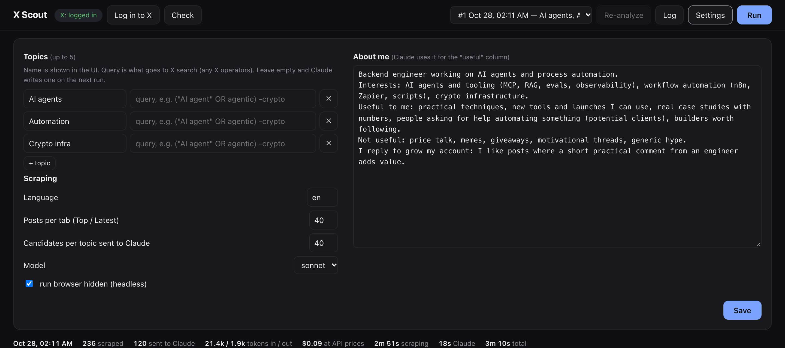
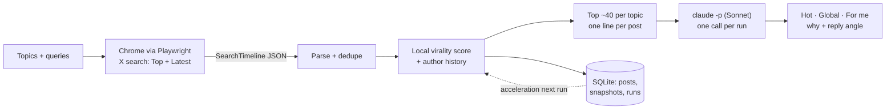

<div align="center">

# X Scout

**Your daily X briefing for up to 5 topics: what is taking off, what everyone talks about, and what is useful to *you*. Runs locally, ranked by Claude.**

[](https://github.com/Sentimenta1ist/x-scout/actions/workflows/test.yml)


[Website](https://sentimenta1ist.github.io/x-scout/) · [How it works](#how-it-works) · [Quick start](#quick-start) · [Token cost](#token-cost)



</div>

## Why

Scrolling X to find posts worth reading or replying to eats an hour a day. Browser agents that scroll and screenshot the feed are slow and burn ~1.5k tokens per screenshot. X Scout does the reading for you:

1. searches X for your topics in a real browser, the way a person would;
2. scores every post for early virality locally, for free;
3. sends only the best ~40 candidates per topic to **one** `claude -p` call as compact text;
4. shows three columns per topic, 3–6 posts each.

| Column | What lands there |
|---|---|
|  **Hot** | Young posts that are taking off right now. Reply early, ride the reach. |
|  **Global** | The most important posts of the day: launches, news, big debates. |
|  **For me** | Useful for *your* work, based on a short profile you write: tools, techniques, people asking for help, builders worth knowing. |

Every card has Claude's one-line take, a suggested **reply angle** (copy button), a 1–5 depth rating, the post metrics and a link to open it on X.

## Features

- **Up to 5 topics**, each with an optional X search query (`OR`, quotes, `-exclude`, `from:` …). Leave it empty and Claude writes one from the topic name and your profile.
- **Real Chrome, no DOM scraping.** Playwright drives your installed Google Chrome with its own profile and reads X's own search JSON. Human-paced: randomized pauses, a few scrolls, nothing is clicked. Stops on a rate limit or a login prompt.
- **Local virality score** (0–100): projected views from age, engagement per view, reach vs the author's usual level (from history, or from followers on day one), and acceleration between runs.
- **One Claude call per run**, tuned for tokens (see [Token cost](#token-cost)).
- **Progress bar with ETA**, run summary (posts, tokens, time), run history, **Re-analyze** to rerun Claude on stored posts without scraping.
- **"Seen" marks**, light and dark theme, works on a phone-width window.
- Everything stays on your machine: SQLite, browser profile and settings live in `data/`.

<table>
<tr>
<td width="50%"></td>
<td width="50%"></td>
</tr>
<tr>
<td align="center"><sub>A run in progress</sub></td>
<td align="center"><sub>Topics, limits and your profile</sub></td>
</tr>
</table>

## How it works



What Claude actually receives per post:

```
12|@mira_builds|18.4k|38m|41.2k|1.2k|164|233|610|86|[img]We put an eval harness in front of every tool call…
```

Posts are referenced by a local index (`12`), not by 19-digit IDs, and Claude answers in a compact line format:

```
# AI agents
H 12 5 | Eval harness on every tool call, failures 14% → 3% | Ask which check caught the most
```

## Quick start

Requirements: macOS or Linux, **Google Chrome**, [uv](https://docs.astral.sh/uv/), and [Claude Code](https://claude.com/claude-code) logged in (`claude` on PATH).

```bash
git clone https://github.com/Sentimenta1ist/x-scout.git
cd x-scout
./run                 # on macOS you can also double-click "X Scout.command"
```

The app opens at http://127.0.0.1:8765.

1. **Log in to X.** A Chrome window opens; log in and it closes itself once you reach the home feed. The session is stored in `data/browser-profile` and lasts for months. Use a **secondary account**: any automation carries some risk for the account that runs it.
2. **Settings.** Add up to 5 topics, write a few lines in **About me** (what you do, what is useful, what is noise). See [`profile.example.md`](profile.example.md).
3. **Run.** 3 topics take ~3 minutes, mostly paced search.

Try the UI without an X account, using made-up demo data:

```bash
X_SCOUT_DATA=./demo-data uv run python scripts/demo.py
X_SCOUT_DATA=./demo-data uv run x-scout
```

## Settings

| Setting | Default | What it does |
|---|---|---|
| Topics | — | Up to 5. Name is shown in the UI, query goes to X search. Empty query → Claude writes one. |
| Language | `en` | `lang:` filter; empty = any language. |
| Posts per tab | 40 | Posts collected from **Top** and from **Latest** for each topic. |
| Candidates per topic | 40 | How many of the best-scored posts go to Claude. Main token knob. |
| Model | `sonnet` | `haiku` is cheaper, `opus` is more thorough. |
| Headless | on | Turn off to watch the browser work. |

Optional `.env` (see [`.env.example`](.env.example)): `PORT`, `CLAUDE_BIN`, `CLAUDE_MODEL`, `X_SCOUT_DATA`.

## Token cost

`claude -p` runs with a short custom system prompt, `--tools ""`, `--setting-sources ""` and an empty working directory, so Claude Code's own overhead is ~1.5k tokens instead of ~20k for a default session. The answer is plain lines rather than `--json-schema`: structured output costs a second model turn that re-reads the whole prompt.

Measured on 3 topics × 25 posts with Sonnet:

| Output format | Input tokens | Output tokens | Time |
|---|---|---|---|
| `--json-schema` | 15.0k | 4.9k | 33 s |
| line format (used) | 6.0k | 1.6k | 15 s |

With the default 40 candidates per topic, a 3-topic run is ~20k input / ~2k output tokens. The run summary shows the exact numbers for every run.

## Volume and safety

- Defaults: 2 search tabs × 40 posts × topics, i.e. up to ~240 posts for 3 topics, with 3–15 s randomized pauses between pages and searches.
- The run stops at the first HTTP 429 or login redirect. Runs start only when you press **Run**: there is no background crawling.
- Nothing is ever liked, followed, posted or clicked.

## Data and privacy

Everything is local and gitignored, in `data/`:

| File | Contents |
|---|---|
| `x-scout.db` | Posts, metric snapshots (for acceleration and author baselines), runs |
| `browser-profile/` | The Chrome profile with your X session |
| `settings.json`, `profile.md` | Your topics and About me |

The only network traffic is Chrome talking to x.com and the Claude CLI talking to Anthropic.

## Development

```bash
uv run pytest                                   # parser, scoring, candidate selection, reply parsing
uv run python scripts/screenshots.py <url>      # re-render docs/img from a running demo server
```

```
x_scout/
  browser.py    Playwright, persistent profile, search + response capture
  parse.py      SearchTimeline JSON → flat posts (handles X schema variants)
  scoring.py    virality score (ported from x-viral-radar)
  analyze.py    candidate selection, compact digest, claude -p, reply parsing
  pipeline.py   run orchestration, progress, settings
  app.py        FastAPI API + static UI
  static/       index.html, app.js, style.css (no build step)
```

The scoring model comes from [x-viral-radar](https://github.com/Sentimenta1ist/x-viral-radar), a Chrome extension that badges posts in your own feed.

## FAQ

**Can it work without logging in?** No. X search requires an account. The session is saved, so you log in once and it lasts for months.

**Why not the official X API?** Search access is expensive for a personal tool. A third-party API backend could be added as an alternative to Chrome later.

**Does it need an Anthropic API key?** No. It uses your logged-in Claude Code CLI.

## License

[MIT](LICENSE). Not affiliated with X Corp. or Anthropic.
